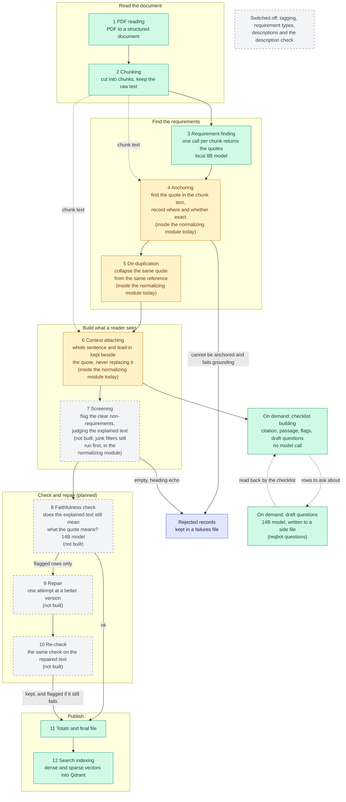
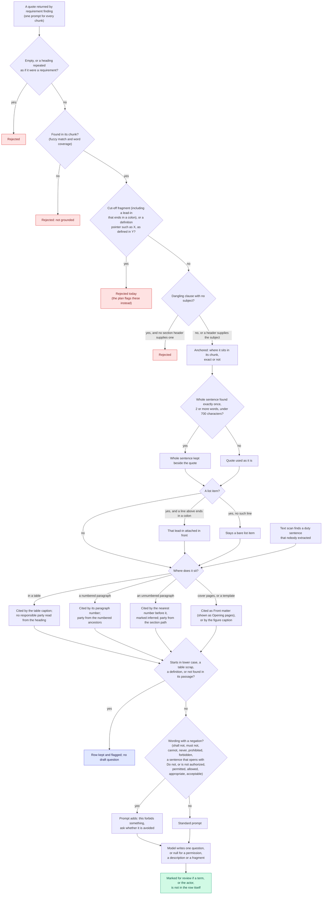
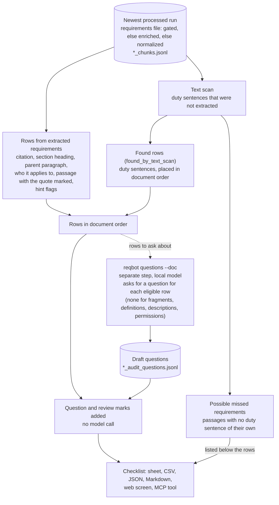

# Architecture overview

[Documentation index](README.md) · [Configuration](CONFIGURATION.md) · [Operations](OPERATIONS.md)

ReqBot has two main workflows: turn PDFs into validated requirement artifacts,
then query an index built from those artifacts. The CLI, web application, HTTP
API, and MCP server expose those workflows.

## Components and ownership

| Component | Responsibility |
|---|---|
| `pipeline/` | Parse PDFs, chunk source text, extract/validate/enrich requirements, export artifacts, and build indexes. |
| `core/` | Configuration, profiles, artifact selection, retrieval, synthesis, and shared utilities. |
| `services/` | Return structured search, trace, comparison, evidence, checklist, status, and configuration results; `job_service.py` queues long commands and runs them one at a time as child processes (state under `<processed_dir>/.jobs/`). |
| `cli/` | CLI and interactive-shell command parsing and presentation. |
| `api/` | HTTP request validation, error mapping, and frontend serving. |
| `mcp_server/` | Read-only tools over shared services: stdio for a local AI client, and an optional HTTP door (`network.py`) for other machines. |
| `frontend/` | Browser screens and presentation; calls the HTTP API. |
| Ollama | Dense embeddings and local extraction, enrichment, query, and synthesis model calls. |
| Qdrant | Rebuildable dense/sparse requirements and source-context indexes. |

Interfaces own presentation and request validation. Retrieval belongs in
`core/ask.py`; pipeline sequencing belongs in `pipeline/run_pipeline.py`.
The [developer reference](../ARCHITECTURE.md) contains the module/import map.

## From document to requirements

| Stage | Work | Main output |
|---|---|---|
| PDF reading | Docling reads layout, headings, tables, and page provenance. | `*_ancestry.json` and an in-memory parsed document. |
| Chunking | Structure-aware chunking adds section paths and parent context; the profile can exclude sections. | `*_chunks.jsonl` |
| Requirement finding | Ollama returns, for each chunk, the quotes that look like duties, with references. The prompt is inclusive: it asks for anything that tells a party what it must, should, may or must not do. Raw responses and parse failures are retained. This output is the **root** of each requirement and is never edited. | `*_extracted_requirements.jsonl` |
| Normalizing and checking | One step today, doing several jobs: validate fields and quote grounding, drop junk (headings, fragments; there is no working change-log rejection yet), attach page and section metadata, deduplicate, record where each quote sits in its chunk and how exactly it matches (the `anchor_*` fields), build the explained text (the whole sentence it sits in), and assign IDs (hashed from the root). Deterministic parent-stem reconstruction follows. | `*_requirements_normalized.jsonl` |
| Enrichment | **Switched off** (October 2026): the code stays, but the pipeline no longer adds descriptions, domain tags or requirement types. | `*_requirements_enriched.jsonl` |
| Description check | **Switched off** with enrichment: there are no generated descriptions to check. | `*_requirements_gated.jsonl` |
| Totals and final file | Aggregate the selected output and record statistics. | `*_final_output.json`, `*_stats.json` |
| Index requirements | Embed selected requirement artifacts with dense Ollama embeddings and sparse BM25 features. | Qdrant `grc_requirements` |
| Index context | Embed source chunks with the same dense/sparse strategy. | Qdrant `grc_context` |

Older documents, log lines and command options name the stages by letter; the naming map
in section 6 of the [redesign plan](PIPELINE_REDESIGN_PLAN.md) translates them. New work uses
the names by job.

The same flow as a picture, laid out as the [redesign plan](PIPELINE_REDESIGN_PLAN.md) lays it out:
one job per step (GitHub draws it from the text below it). Green steps are built and run on
their own; amber steps work today but still run inside the normalizing module together with other jobs;
grey dashed steps are in the plan and not built, or switched off. The steps run in order, but not
every record takes every path: records that cannot be anchored or are empty are set aside, and
only rows the faithfulness check flags go through repair.

### How one requirement is treated, by kind

Not every requirement takes the same path. This chart follows one quote through the places where
the code makes a different choice depending on what the quote is. Red boxes are records that are
set aside. Where a box says "the plan flags these instead", the redesign plan replaces a
rejection with a flag.

What this chart does not show is that several things are *not* decided by kind. Requirement
finding sends every chunk through the same prompt, whether it holds a paragraph, a list, a
table or a definition. No stored field records what kind of requirement a quote is (a duty, a
prohibition, a permission, a definition, a statement of who the document applies to, a table
row, an instruction inside a form template); the later steps each rediscover the parts of that
they need, from the wording, with their own rules.

One of those rules is under test: the negation test in the chart reads a plain "does not" in a
condition or a description ("... if this capability does not exist") as a prohibition, which can
turn a duty into the question "does the unit avoid ...". A narrower test is being evaluated.

A note on the red boxes: the code has six rejection checks, but in the October 2026 runs of
the 13 documents only three kinds of rejection occurred: not found in the chunk (117 records),
cut-off fragment (93) and repeated heading (40). The empty-quote, definition-pointer and
dangling-clause checks did not fire. A change-log rejection does not exist: an earlier one read a
generated description, which is always empty, and was removed.

### Planned changes

The [pipeline redesign plan](PIPELINE_REDESIGN_PLAN.md) describes where the pipeline is
going. Built so far: the anchor fields, the root kept untouched with the explained text
beside it, enrichment and the description check switched off, `confidence` dropped, and
readers showing the explained text. Still to come: the normalizing module split into separate steps and
screening on the explained text. In short: the root stays exactly as the model returned it and is never edited;
checking that the root is word for word in the source becomes its own early step
(anchoring); the whole-sentence expansion and lead-in attachment move into a separate
"explained" layer beside the root; screening judges that explained text; the normalizing module is split
so each step does one job; and tagging, typing, descriptions and the description check
are switched off, with the explained text used in their place.

The CLI `ingest` command runs indexing by default. The direct pipeline script
writes artifacts by default and requires `--index` to index. See [CLI](CLI.md)
and [Operations](OPERATIONS.md#resume-an-interrupted-run).

### What validation establishes

Normalizing and checking applies known-chunk grounding checks that combine
fuzzy character matching and a word-coverage threshold. They reject some invented quotes
while preserving formatting variants and list obligations the model joined to their
lead-in. These are heuristic checks, not proof that every quote is verbatim or
semantically faithful: in the October 2026 run of the 13 reference documents, 7% of
accepted quotes (172 of 2,419) are not word for word in their chunk (most often a lead-in glued onto a list item, or a dropped
list number), and the checklist marks them `quote_not_located_in_passage`.

Each accepted quote is then expanded, best effort, to the whole sentence it sits in
(verbatim, with spacing tidied; `pipeline/sentence_expand.py`). A quote that cannot be
found exactly once in its chunk, or whose sentence is very long, or that is a single
word, is left as the model returned it, so some accepted quotes stay incomplete or not
word for word. The expansion never replaces `source_quote`, which stays exactly as
requirement finding returned it (the root); the expanded sentence is stored beside it in
`explained_text`, with the pieces it was built from in `explained_parts` and a short
note of what was done in `explain_notes`. Where the source backs it, a lead-in the
model glued onto a list item is kept in front of the sentence.

Parent-stem reconstruction attaches `parent_stem` and combined `embedding_text`
to fragment records while preserving their `source_quote`.
Generated descriptions are distinct from source quotes. The description check has
deterministic checks and, when the optional MiniCheck dependency is available,
an entailment check. A rejected description is cleared; its requirement remains.

Enrichment failures can fall back to normalized artifacts. A description-gate
failure can fall back to the pre-gate artifact, with a log warning. Inspect logs
and failure artifacts when assessing a run; completion alone does not mean every
optional check executed. Human review of source quotes remains necessary.

## Checklists

A checklist is built on demand from the newest processed run of a document; building it
never calls a model. Each row is one requirement with its citation, section heading,
the paragraph it sits under (read from the document's own numbering), who it applies to,
the surrounding passage with the quote marked, and hint flags (for example "starts
mid-sentence" or "table fragment"). Duty sentences in paragraphs (numbered or not) that look like duties but were not
extracted become ordinary rows in their place in the document, flagged `found_by_text_scan` (a paragraph with no number of its own is cited
by inference, marked "(inferred)", or not at all); other passages of that kind, such as a purpose statement with no duty sentence, are listed
separately as possible missed requirements. Draft audit questions
come from `reqbot questions`, which writes a sidecar file (`*_audit_questions.jsonl`) that
the checklist reads; they are drafts for the auditor to check.

How one checklist is put together. Building it reads files only; the one model call is the
separate `reqbot questions` step, whose output the checklist reads back:

## Artifacts and the source of record

Keep original PDFs and complete processed run directories. They allow inspection,
resume, later validation, and rebuilding without asking the extraction model
to regenerate the corpus.

| Artifact | Purpose |
|---|---|
| `*_ancestry.json`, `*_chunks.jsonl` | Source structure and the text shown to extraction. |
| `*_raw_responses.jsonl` | Extraction model responses and resume/cache evidence. |
| `*_extracted_requirements.jsonl`, `*_parse_failures.jsonl` | Parsed extraction output and parsing errors. |
| `*_requirements_normalized.jsonl`, `*_normalization_failures.jsonl` | Accepted normalized records and rejection reasons. |
| `*_requirements_enriched.jsonl` | Added descriptions/classifications before description checking. |
| `*_requirements_gated.jsonl`, `*_description_gate_failures.jsonl` | Post-check records and rejected-description evidence. |
| `*_final_output.json`, `*_stats.json` | Aggregated export and run metrics. |
| `*_audit_questions.jsonl` | Draft audit questions written by `reqbot questions`; read by the checklist. |
| `*_criticality.jsonl` | Rough criticality scores written by `reqbot questions` (a second model call per row); read by the checklist, which shows a Critical, High, Medium or Low band by rank within the document. |
| `*_cleanup.jsonl` | Optional "probably not a requirement" flags written by `reqbot questions --cleanup` (a third model call per row); read by the checklist, which adds `· junk` to the priority cell. Nothing is removed. |

Some artifacts are absent when their stage is skipped or fails. Reindex and
checklist generation share an artifact resolver: pick the run with the most
recently modified requirement artifact, then prefer gated over enriched over
normalized, provided the higher tier is not older than a lower tier. A stale
gated file must not override a later normalization rerun.

The document-listing service instead counts the latest normalized files. Its
counts describe processed artifacts, not a live Qdrant inventory.

## Search and trace

Search can rewrite the question into retrieval keywords and generate a HyDE
hypothesis. Dense question/hypothesis embeddings and sparse keyword features
retrieve candidates; reciprocal rank fusion combines the ranked lists.
Document, tag, and requirement-type filters constrain results.

An RRF score is a ranking score, not a probability of correctness. Optional
context fetches the source chunks linked to returned requirements from
`grc_context`. It does not alter stored requirements.

Trace looks up a known requirement ID and returns its payload, other records
sharing its citation, and optional surrounding chunk text. Shared references
help comparison; matching `source_ref` values are not proof of equivalent scope.

Answer synthesis is a separate, optional step over retrieved records. It can
use local Ollama, an explicitly configured remote provider, or be disabled.
Local retrieval still requires Ollama when remote synthesis is selected.
The experimental cross-encoder reranker is opt-in programmatically and has not
become a default retrieval step.

## Indexes and identity

`grc_requirements` stores requirement payloads and vectors. `grc_context` stores
source chunks and vectors. Indexed payloads retain embedding model/dimension
provenance; result warnings help identify a corpus built with another model.
Each requirement payload also carries `citation`, the reference the checklist gives
that row (a paragraph number, a table such as `Table 3.1`, `Front matter`, which readers see as "Opening pages"), read from
the document's own text when the index is built by the same function the checklist
uses (`services/checklist_service.py`, passed to the indexer by the CLI's indexing commands and by the direct scripts' `--index` path). It
sits beside `source_ref` and never replaces it: Evidence groups by `source_ref`, and
the embedded text carries it, so the label changes no vector. Readers show
`citation`, else `source_ref` (`core/display.py: requirement_citation`).

- `doc_key`: PDF filename stem used for artifact lookup and checklists.
- `source_pdf`: PDF filename used in source filters and presentation.
- `document_id`: PDF-content-derived identifier in normalized/indexed records.
- `requirement_id`: record identifier returned by search and accepted by trace.
- `chunk_id`: link to the source chunk within that document.

Use returned identifiers instead of fabricating IDs. A filename stem is not
interchangeable with the content hash in every interface.

Reindex builds replacement collections and swaps aliases after each successful
build. Requirements and context have separate swaps; the pair is not one
transaction. Migrating a plain collection to an alias can require a brief
availability gap. See [Operations](OPERATIONS.md#rebuild-the-search-indexes).

## Deployment boundaries

The default API listener is loopback, with no application authentication.
The MCP server is a subprocess using stdio. The optional network door (`reqbot mcp --http`) serves the same read-only tools over HTTP to other machines, only with a valid per-tool access code, and is not running unless started; see the [network MCP diagram](diagrams/13_network_mcp.md).
The web GUI requires a frontend build. See [Deployment](DEPLOYMENT.md),
[Connecting AI tools](AI_TOOLS.md), and [API](API.md) for those interfaces.
