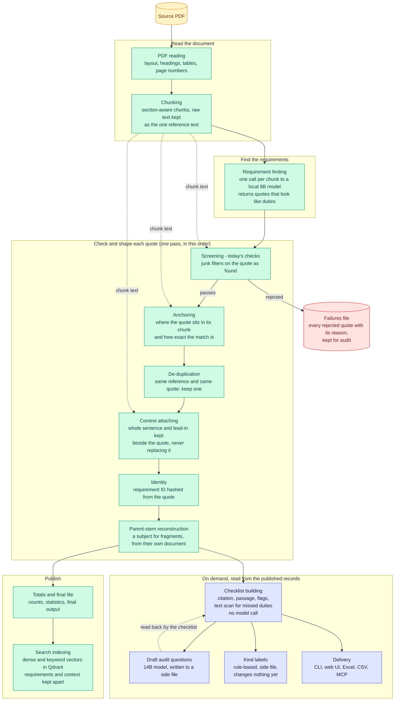

# Overview

The whole path today, in the order the code runs it.

Screening comes before anchoring because that is how the code runs. The plan moves screening onto the explained text; that is on the roadmap diagram, not here.

Back to the [diagram index](README.md).
