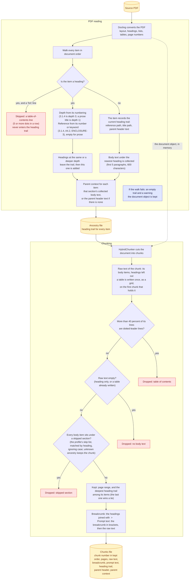

# PDF reading and chunking

How a PDF becomes chunks that know which section they sit in.

Three kinds of chunk are dropped before any model sees them: table of contents, no body text, and skipped sections. A chunk is kept whenever its section is uncertain.

Back to the [diagram index](README.md).
