# Requirement finding

How each line of a chunk is labeled, and which lines become rows. The model never writes text: every row is the document's own line.

```mermaid
flowchart TD
    IN[("Chunks file<br/>each chunk's raw text, heading and section path")]
    C1["Cut each chunk into clauses by rule (no model):<br/>read line by line; a line with no two letters in a row ends the block;<br/>a line is joined to the one above unless it starts a list item or table row,<br/>or the one above already ends a sentence or a lead-in (colon);<br/>each block is cut into sentences (not after an abbreviation<br/>or a short section number); each clause keeps its exact offsets"]
    C2["Each clause gets its context for the prompt:<br/>the chunk's heading, its paragraph reference,<br/>and the nearest lead-in line above it in the same chunk"]
    B1["Clauses in document order, 4 per call<br/>(a call may span two chunks)"]
    R1{"Same clauses, same model,<br/>same filled prompt as a batch<br/>finished in an earlier run?"}
    REUSE["Reused from the raw responses file:<br/>no model call"]
    R2["The frozen labeling prompt (its sha256 is checked)<br/>temperature 0, thinking off, 8192-token context<br/>the configured extraction model (ornith:35b measured)"]
    R3{"The request failed after 3 retries?"}
    F1["Batch failed: its chunks get no rows<br/>the next run in the same folder redoes it<br/>(5 failures in a row stop the run: not_attempted)"]
    R4{"A JSON list with ids 1 to 4,<br/>each label one of five?"}
    R5["Second attempt"]
    F2["Still unreadable: every clause in the batch<br/>labeled UNSURE (kept for a reader)<br/>a line in the parse failures file"]
    L{"The clause's label"}
    DROP["NOT_REQUIREMENT: no row"]
    ROW["DUTY, PROHIBITION, PERMISSION or UNSURE: a row<br/>source_quote = the clause, whitespace tidied<br/>anchor_status exact, anchor_start and anchor_end from the splitter<br/>clause_label, clause_index, label_prompt_sha"]
    REF["source_ref by rule, with source_ref_origin:<br/>own_number (the number the clause opens with or sits under),<br/>else table_caption (a table line), else number_above (last number above in the chunk),<br/>else section_path (last numbered section entry), else none"]
    OUT[("Extracted requirements file<br/>rewritten whole from the ledger on every run")]
    RAW[("Raw responses file: one line per batch<br/>status complete, unparsed or failed")]

    IN --> C1 --> C2 --> B1 --> R1
    R1 -->|yes| REUSE
    R1 -->|"no (a failed batch is redone)"| R2
    R2 --> R3
    R3 -->|yes| F1
    R3 -->|no| R4
    R4 -->|no, first time| R5
    R5 --> R4
    R4 -->|"no, second time"| F2
    R4 -->|yes| L
    REUSE --> L
    F2 --> L
    L -->|NOT_REQUIREMENT| DROP
    L -->|any other label| ROW
    ROW --> REF --> OUT
    F1 --> RAW
    R4 --> RAW

    classDef built fill:#d1fae5,stroke:#059669,color:#064e3b;
    classDef fail fill:#fee2e2,stroke:#dc2626,color:#7f1d1d;
    classDef keep fill:#fef3c7,stroke:#d97706,color:#78350f;
    classDef side fill:#e0e7ff,stroke:#4f46e5,color:#1e1b4b;
    classDef drop fill:#f3f4f6,stroke:#6b7280,color:#374151;
    class ROW,REF built;
    class F1 fail;
    class F2 keep;
    class OUT,RAW,IN keep;
    class REUSE side;
    class DROP drop;
```

Before the first call the model server is checked: if it cannot be reached, or if not one batch could be labeled, the run stops with an error rather than write an empty document. Every line not labeled NOT_REQUIREMENT becomes a row, UNSURE included. A list's lead-in line ends in a colon, so it is labeled like any line but rejected by normalizing; it is put in front of its items in the explained text instead. Each table line is one clause. This step replaced the one that asked the model to write a list of requirements (deleted in October 2026, no switch back).

Back to the [diagram index](README.md).
