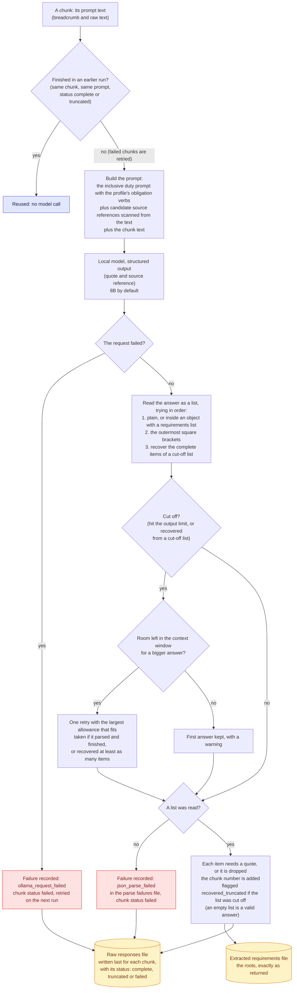

# Requirement finding

What happens to each chunk when the model is asked for the duties in it.

A chunk that failed is retried on the next run; a finished chunk is reused, not asked again. The quotes that come back are the roots and are never edited.

Back to the [diagram index](README.md).
