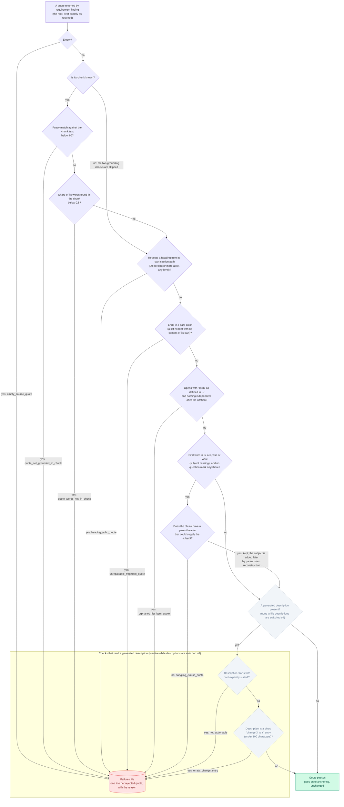

# Screening

Which quotes are rejected, and in what order the checks run.

Every rejection is written to the failures file with the label shown on the arrow. Passing quotes continue unchanged.

Back to the [diagram index](README.md).
