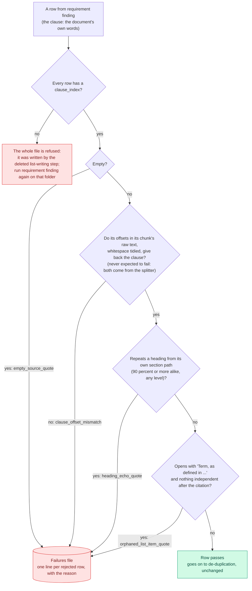

# Screening

Which rows are rejected in normalizing, and in what order the checks run.

Every rejection is written to the failures file with the label shown on the arrow. The fuzzy-match and word-share grounding checks and the missing-subject rejection were deleted with the list-writing step: a clause is the document's own line, so there is nothing invented to catch, and a subject-less line ("Is responsible for ...") is a real line under its list's lead-in.

Back to the [diagram index](README.md).
