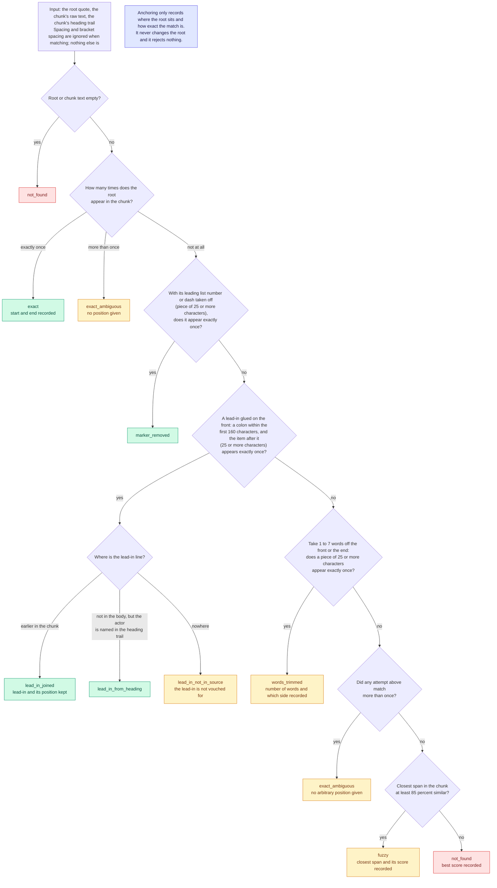

# Anchoring

How exactly each quote is found in its chunk.

A ladder: the first rung that matches decides the status. Statuses are records only; nothing is accepted or rejected on them.

Back to the [diagram index](README.md).
