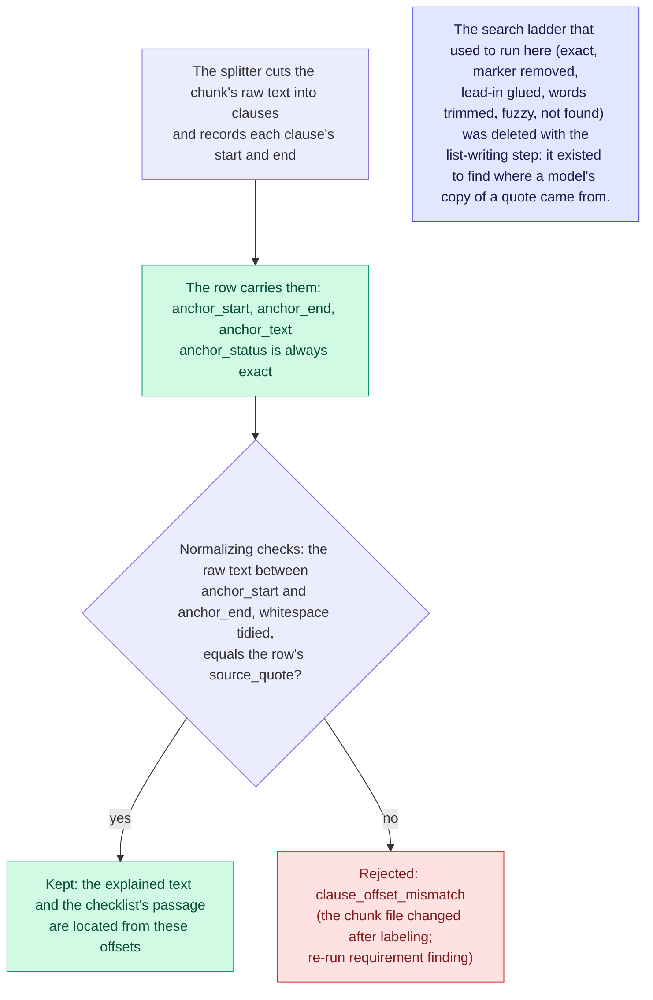

# Anchoring

Where each row sits in its chunk. Since clause labeling, this is a fact the splitter records, not a search.

Records from before the switch keep the anchor statuses they were written with; nothing reads them to accept or reject a row.

Back to the [diagram index](README.md).
