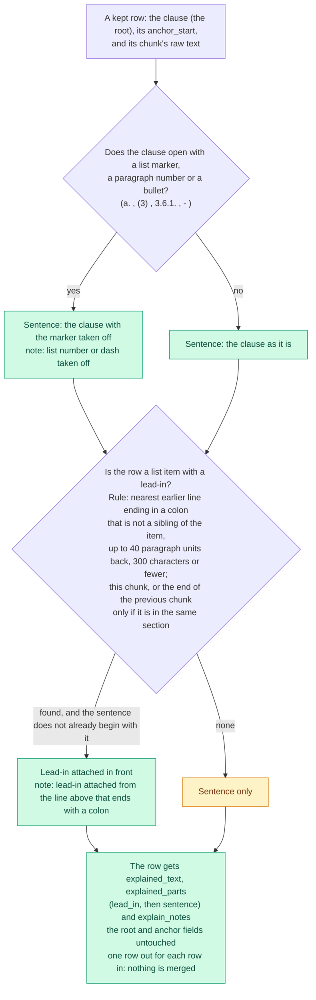

# Context attaching

How the explained text beside each row is built.

The explained text is a separate layer beside the root, built only from the document's own words. Stretching a partial quote to its whole sentence and merging rows that reached the same sentence were deleted with the list-writing step: a clause is already a whole line of the document.

Back to the [diagram index](README.md).
