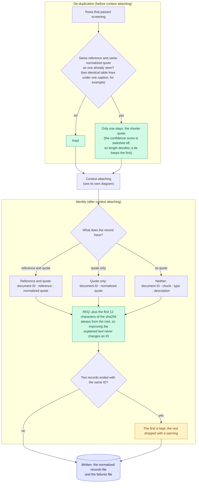

# De-duplication and identity

De-duplication and requirement IDs.

De-duplication runs before context attaching; IDs come after it. Parent-stem reconstruction, which used to run on the written file, was deleted with the list-writing step: the lead-in rule in context attaching gives a list item its governing line from the document itself.

Back to the [diagram index](README.md).
