# De-duplication, identity and parent stems

De-duplication, requirement IDs, and subjects for fragments.

```mermaid
flowchart TD
    subgraph DEDUP["De-duplication (before context attaching)"]
        D0["Quotes that passed screening, with anchor fields"]
        D1{"Same reference and same normalized quote<br/>as one already seen?<br/>(or same reference and same description,<br/>when a description exists)"}
        D2["Kept"]
        D3["Only one stays: the shorter quote<br/>(the confidence score is switched off,<br/>so length decides; a tie keeps the first)"]
        D0 --> D1
        D1 -->|no| D2
        D1 -->|yes| D3
    end

    CA["Context attaching<br/>(see its own diagram)"]
    D2 --> CA
    D3 --> CA

    subgraph ID["Identity (after context attaching)"]
        I1{"What does the record have?"}
        I2["Reference and quote:<br/>document ID : reference : normalized quote"]
        I3["Quote only:<br/>document ID : normalized quote"]
        I4["Neither:<br/>document ID : chunk : type : description"]
        I5["REQ- plus the first 12 characters of the sha256<br/>always from the root, so improving the<br/>explained text never changes an ID"]
        I6{"Two records ended with the same ID?"}
        I7["The first is kept, the rest dropped with a warning"]
        I1 -->|"reference and quote"| I2
        I1 -->|"quote only"| I3
        I1 -->|"no quote"| I4
        I2 --> I5
        I3 --> I5
        I4 --> I5
        I5 --> I6
        I6 -->|yes| I7
    end

    CA --> I1
    I6 -->|no| W
    I7 --> W
    W[("Written: the normalized records file<br/>and the failures file")]

    subgraph STEM["Parent-stem reconstruction (in place, on the written file)"]
        S0{"Short quote (20 words or fewer),<br/>starts with a list marker,<br/>or has a dangling start?"}
        S1{"1. An earlier quote in the same chunk that can serve as a stem<br/>(walks back past sibling list items)?"}
        S2{"2. Chunk opens mid-list (first marker is not 1, a or i):<br/>a stem from the previous chunk?"}
        S3{"3. Dangling start and the chunk has a parent header?"}
        S4["Stem found: parent_stem and embedding_text<br/>(stem plus the explained text) written<br/>root and ID untouched"]
        S5["No stem: both fields left empty"]
        S0 -->|no| S5
        S0 -->|yes| S1
        S1 -->|yes| S4
        S1 -->|no| S2
        S2 -->|yes| S4
        S2 -->|no| S3
        S3 -->|"yes: the header is the stem"| S4
        S3 -->|no| S5
    end

    W --> S0

    classDef ok fill:#d1fae5,stroke:#059669,color:#064e3b;
    classDef keep fill:#fef3c7,stroke:#d97706,color:#78350f;
    classDef data fill:#e0e7ff,stroke:#4f46e5,color:#1e1b4b;
    class D2,D3,I5,S4 ok;
    class I7,S5 keep;
    class W data;
```

De-duplication runs before context attaching; IDs and parent stems come after it.

Back to the [diagram index](README.md).
