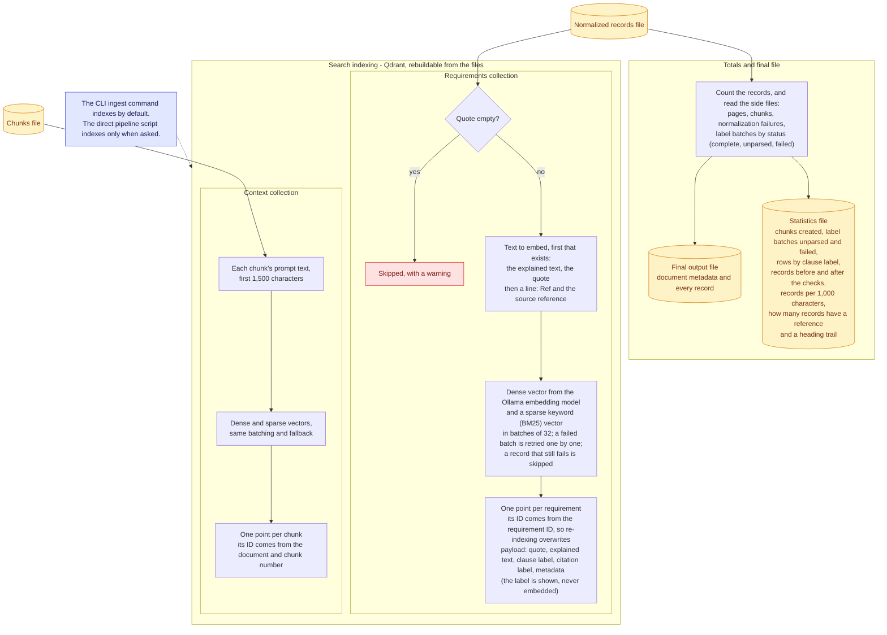

# Totals and search indexing

What is written at the end, and what goes into search.

The files are the record. The search index can always be rebuilt from them.

Back to the [diagram index](README.md).
