# Checklist building

How each row gets its citation, party, flags and passage.

```mermaid
flowchart TD
    REQ[("Published records file<br/>best tier available:<br/>gated, then enriched, then normalized")]
    CH[("Chunks file, beside it")]
    SIDE[("Draft questions side file<br/>(optional)")]

    subgraph MAPS["Read once from the document's own text"]
        M1["Heading map: paragraph number to title<br/>from numbered headings and run-in titles"]
        M2["Paragraph map: paragraph number to text"]
        M3["First chunk that holds a numbered paragraph<br/>(for front matter)"]
    end

    subgraph ROW["For each published record"]
        S0{"Has a requirement ID and a quote?"}
        SK["Skipped, counted in the log"]
        S1["Shown text: the explained text, else the root<br/>Locating text: the sentence itself, else the root"]
        S2{"Does the row sit in a table?"}
        T1["Cited by the table caption (Table 3.1)<br/>no party is read from the heading<br/>read straight from the document, never inferred"]
        C1["Citation, first that works:<br/>1. the extracted reference, if it is a paragraph number<br/>2. the number the quote itself opens with<br/>3. inferred, marked (inferred): the last paragraph number<br/>before the marked requirement in its passage<br/>(the passage is built first, then the citation is settled)<br/>4. the nearest numbered heading<br/>5. nothing numbered: Figure A3.1 or Front matter"]
        P1["Applies to: from the numbering<br/>the nearest numbered ancestor's title when it names the party<br/>(a responsibilities section, or a title that introduces a list)<br/>A row with a dotted number never falls back to the section path<br/>No dotted number: the leaf heading, if it names the party"]
        F1["Six hint flags, from the wording:<br/>starts_mid_sentence, list_item, table_fragment,<br/>no_stated_actor, applicability_statement,<br/>definition_or_description"]
        PS1["Passage: the chunk's own text, quote marked with  >> <<<br/>the end of the previous chunk goes in front<br/>for a list item, a mid-sentence start, or a rule lead-in"]
        PS2{"Passage result"}
        PS3["no_passage flag<br/>(chunk missing)"]
        PS4["quote_not_located_in_passage flag<br/>(whole chunk shown, unmarked)"]
        PR["Parent paragraph: nearest numbered ancestor<br/>present in the document, text cut at a word"]
        RR["Review reasons: no source reference, no section path,<br/>no page numbers, low confidence (when a record has one),<br/>profile mismatch"]
        POS["Position kept: chunk and offset in the chunk"]
    end

    SCAN["Text scan: duty sentences nobody extracted<br/>(its own diagram)"]
    MERGE["Merge in document order<br/>by chunk and offset"]
    APPLY["Draft questions applied<br/>from the side file<br/>(never a model call here)"]
    ENV[("Checklist<br/>items, possible missed, summary counts")]

    REQ --> S0
    CH --> MAPS
    MAPS --> S2
    S0 -->|no| SK
    S0 -->|yes| S1
    S1 --> S2
    S2 -->|yes| T1
    S2 -->|no| C1
    T1 --> F1
    C1 --> P1
    P1 --> F1
    F1 --> PS1
    PS1 --> PS2
    PS2 -->|"no chunk"| PS3
    PS2 -->|"quote not found"| PS4
    PS2 -->|"found"| PR
    PS3 --> PR
    PS4 --> PR
    PR --> RR
    RR --> POS
    CH --> SCAN
    POS --> MERGE
    SCAN -->|"promoted rows"| MERGE
    MERGE --> APPLY
    SIDE --> APPLY
    APPLY --> ENV
    SCAN -->|"possible missed, listed apart"| ENV

    classDef built fill:#d1fae5,stroke:#059669,color:#064e3b;
    classDef drop fill:#fee2e2,stroke:#dc2626,color:#7f1d1d;
    classDef data fill:#fef3c7,stroke:#d97706,color:#78350f;
    classDef side fill:#e0e7ff,stroke:#4f46e5,color:#1e1b4b;
    class SK,PS3,PS4 drop;
    class REQ,CH,ENV data;
    class SIDE,SCAN,APPLY side;
```

No model is called when a checklist is built. A row with a flag is still a row; flags are hints for a reader.

Back to the [diagram index](README.md).
