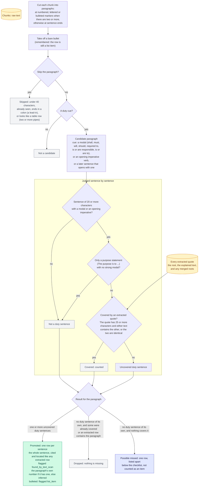

# Text scan

How duties that nobody extracted are found.

A rule-based net for a reader. A paragraph with no duty sentence of its own is listed apart and is not counted as an item.

Back to the [diagram index](README.md).
