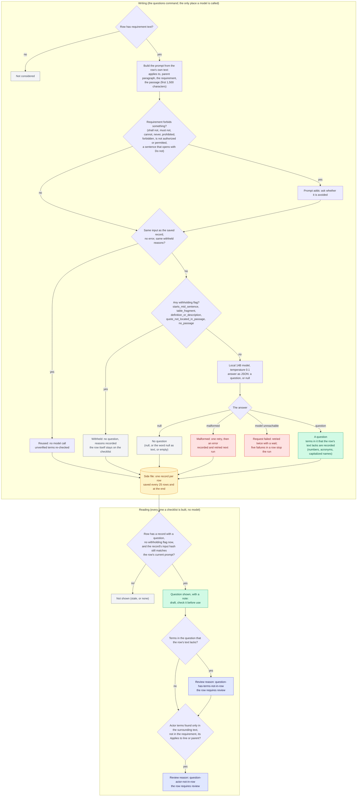

# Draft audit questions

How a draft question is written, withheld and read back.

The questions command is the only model call in the checklist path. Withheld rows stay on the sheet; they just have no draft question.

Back to the [diagram index](README.md).
