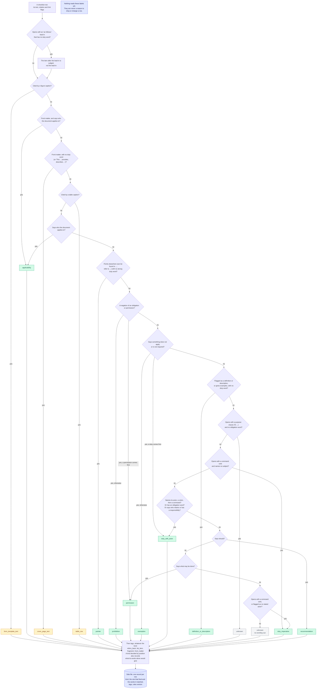

# Kind labels

How each row is labelled by what sort of statement it is.

The first rule that matches decides. Nothing reads these labels yet; they never drop or change a row.

Back to the [diagram index](README.md).
