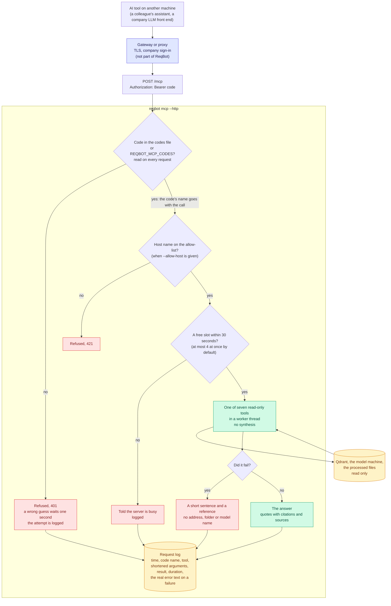

# Network MCP door

How a call from an AI tool on another machine is let in, run, and written down.

Only the seven read-only tools exist behind this door. A code opens nothing else: it is not the admin code, and no tool adds, changes or removes a document.

Back to the [diagram index](README.md).
