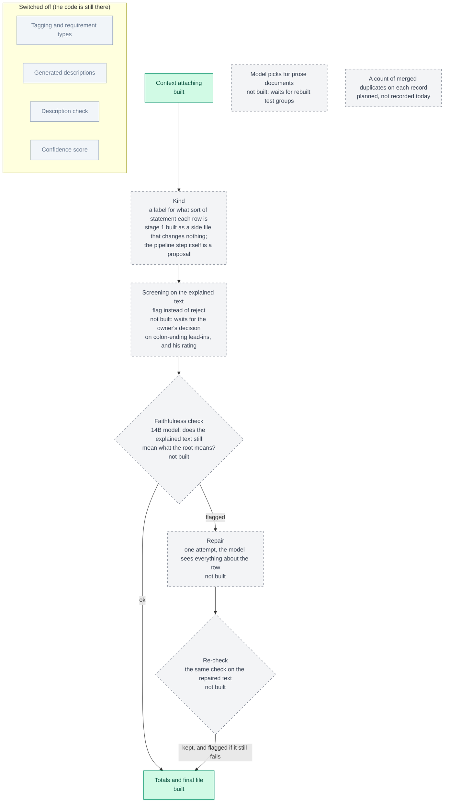

# Roadmap: planned or switched off

What is planned or switched off, kept apart from what runs.

Green boxes run today and are shown only to place the rest. No dashed box runs in the pipeline, and grey boxes are switched off. Kind labels exist only as a side file that nothing reads yet.

Back to the [diagram index](README.md).
